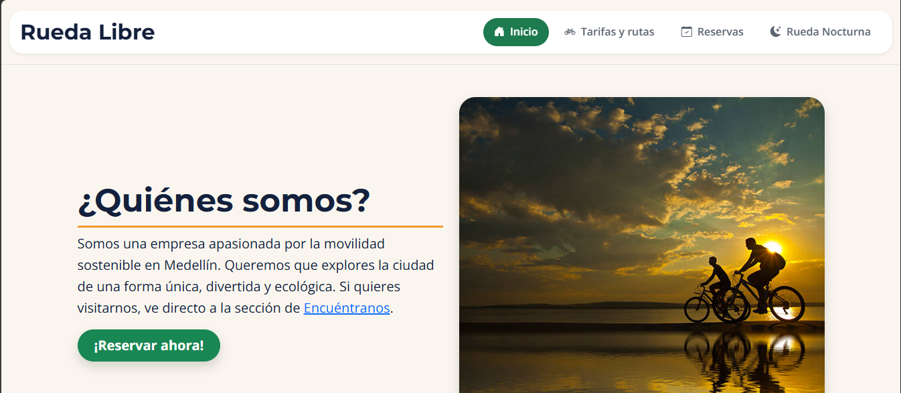
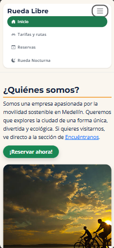
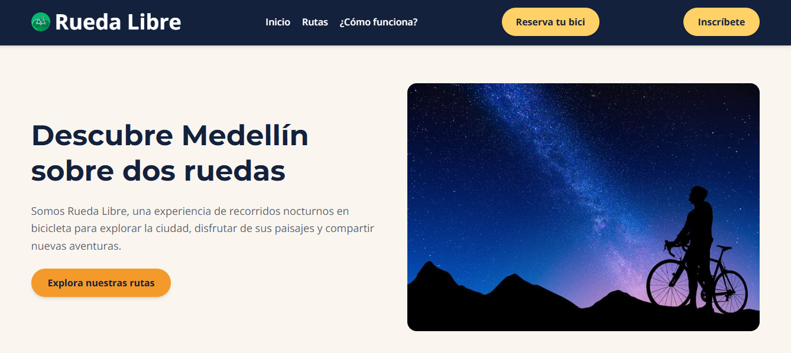
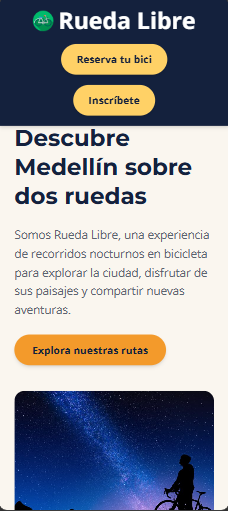
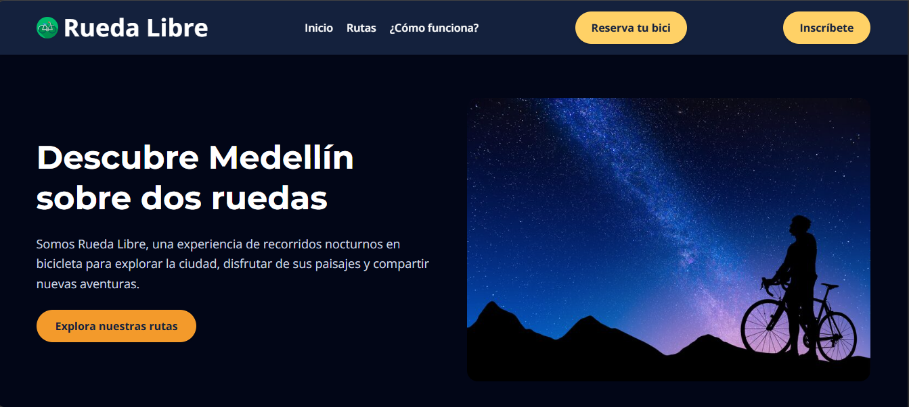

# Rueda Libre – Proyecto web

## 1. Descripción del proyecto

Rueda Libre es un proyecto web enfocado en el alquiler de bicicletas y en la promoción de recorridos por Medellín.

El proyecto cuenta con un sitio web principal desarrollado con Bootstrap y una landing page complementaria llamada **Rueda Nocturna**, desarrollada con Tailwind CSS. Esta última presenta una campaña de recorridos nocturnos en bicicleta e incluye información sobre las rutas y un formulario de inscripción.

## 2. Enlaces del proyecto

- **Repositorio en GitHub:** https://github.com/Juli-1997/Rueda_librejul/tree/semana-3-dia-3
- **Sitio web publicado:** https://juli-1997.github.io/Rueda_librejul/index.html
- **Landing Rueda Nocturna:** https://juli-1997.github.io/Rueda_librejul/nocturna/index.html

## 3. Páginas desarrolladas

### Sitio original – Rueda Libre

Sitio web principal desarrollado con Bootstrap. Incluye las secciones y páginas informativas del servicio de alquiler de bicicletas.

### Landing page – Rueda Nocturna

Página desarrollada con Tailwind CSS para promocionar recorridos nocturnos en bicicleta. Incluye:

- Información de las rutas disponibles.
- Distancia, duración, dificultad y precio de los recorridos.
- Beneficios y elementos incluidos en la experiencia.
- Formulario de inscripción.
- Adaptación a diferentes tamaños de pantalla.
- Alternancia entre modo claro y modo oscuro.

## 4. Tecnologías utilizadas

- **HTML5:** estructura y organización del contenido.
- **CSS3:** estilos y presentación visual.
- **JavaScript:** funcionalidades e interacciones.
- **Bootstrap 5.3.3:** framework utilizado en el sitio original.
- **Tailwind CSS 4.3.5:** framework utilizado en la landing Rueda Nocturna.
- **Git y GitHub:** control de versiones y publicación del proyecto.
- **Visual Studio Code:** entorno de desarrollo.

## 5. Recomendación para el MiniReto 8

Para el desarrollo de una nueva página del proyecto, recomiendo utilizar **Tailwind CSS** cuando se necesite una personalización visual más específica.

Durante el desarrollo de Rueda Nocturna fue posible definir colores propios, crear componentes reutilizables y adaptar los estilos a las necesidades de la página mediante clases de utilidad.

Bootstrap también es una buena alternativa cuando se busca desarrollar rápidamente utilizando componentes prediseñados, como botones, formularios, tarjetas y barras de navegación.

La elección depende de las necesidades del proyecto y del nivel de personalización que se quiera alcanzar.

## 6. Capturas del proyecto

### Sitio original – Bootstrap

**Versión escritorio**

**Versión móvil**

### Landing Rueda Nocturna – Tailwind CSS

**Versión escritorio**

**Versión móvil**

### Adaptación de tema

**Modo oscuro de Rueda Nocturna**

## 7. Accesibilidad y diseño responsive

Durante el desarrollo se revisaron aspectos de accesibilidad y adaptación a diferentes dispositivos, entre ellos:

- Uso de etiquetas HTML semánticas.
- Organización jerárquica de encabezados.
- Textos alternativos para imágenes.
- Navegación mediante teclado.
- Indicadores visibles de enfoque en elementos interactivos.
- Contraste entre texto y fondo.
- Adaptación de la interfaz a diferentes tamaños de pantalla.

Se realizaron pruebas de visualización en resoluciones de escritorio, tablet y móvil, incluyendo un ancho de 360 px.

## 8. Formularios y validación

Se trabajó en la estructura y validación de formularios para facilitar el ingreso de información.

En el formulario de inscripción de Rueda Nocturna se incluyeron campos para los datos personales, selección de ruta, día de salida, número de acompañantes, nivel de experiencia, disponibilidad de bicicleta propia y aceptación de condiciones.

## 9. Identidad visual

Se utilizaron colores y estilos relacionados con la identidad de Rueda Libre.

En la landing Rueda Nocturna se incorporó una paleta de tonos oscuros y colores de acento para representar la temática nocturna, manteniendo la legibilidad del contenido.

También se implementó la adaptación entre tema claro y oscuro para la landing.

## 10. Optimización y herramientas de desarrollo

Se utilizaron las herramientas de desarrollo del navegador para revisar la presentación, detectar errores y analizar los recursos cargados.

En la landing se configuró Tailwind CSS mediante su CLI y se generó el archivo `src/output.css` a partir de `src/input.css`.

Finalmente, se utilizó la opción `--minify` para generar una versión comprimida del CSS de producción.

## 11. Problemas encontrados y soluciones

Durante el proceso se presentaron dificultades relacionadas con:

- Rutas relativas de archivos e imágenes.
- Recursos que no se encontraban y generaban errores 404.
- Adaptación de componentes a pantallas pequeñas.
- Organización de estilos y clases.
- Configuración de Tailwind CSS mediante la terminal.
- Generación y minificación del archivo CSS.
- Ajustes de colores y estilos para el modo claro y oscuro.

Estos problemas se fueron resolviendo mediante pruebas, revisión del código y uso de las herramientas de desarrollo.

## 12. Aprendizajes

Este proyecto permitió practicar la construcción de páginas web utilizando HTML, CSS y JavaScript, además de trabajar con Bootstrap y Tailwind CSS.

También permitió comprender mejor el diseño responsive, la accesibilidad, la organización de archivos, el uso de Git y GitHub, la reutilización de estilos y la optimización de archivos CSS.

## 13. Registro del proceso

El desarrollo y las actividades realizadas durante las diferentes semanas se encuentran documentados en el archivo `bitacora.txt`, que contiene el registro de ejercicios, pruebas, dificultades y soluciones.

## 14. Autor

**Nombre:** Juliana del Carmen Castellar Pretel  
**Proyecto:** Rueda Libre  
**Institución:** Riwi
